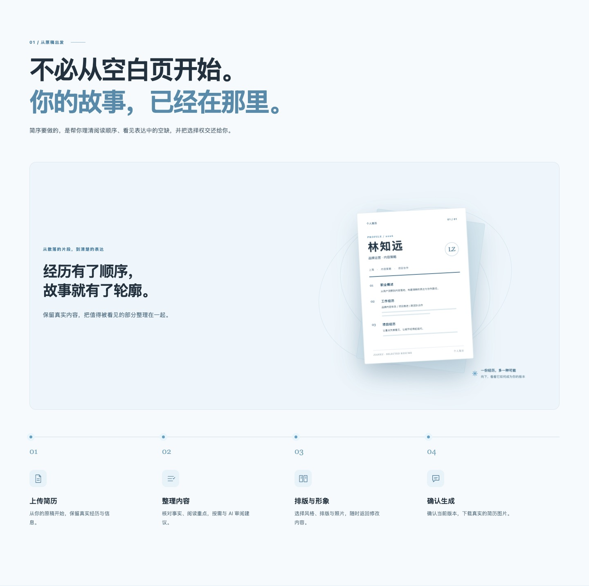
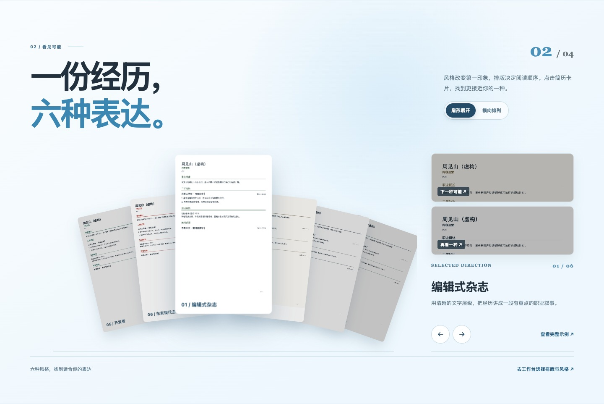
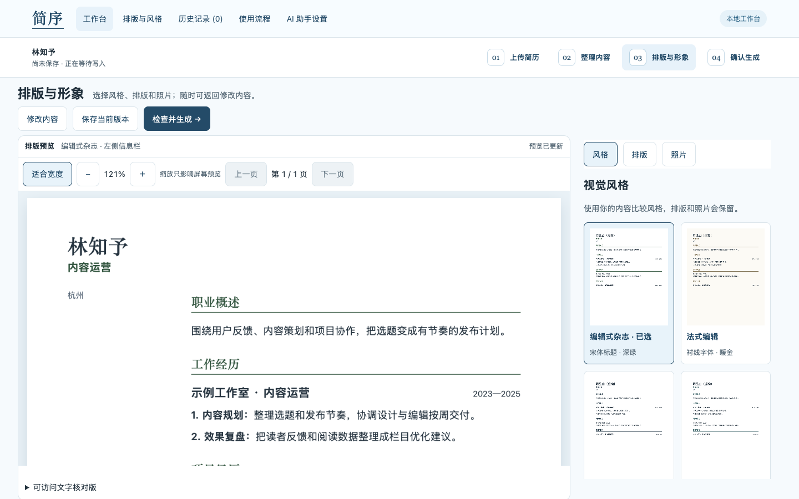
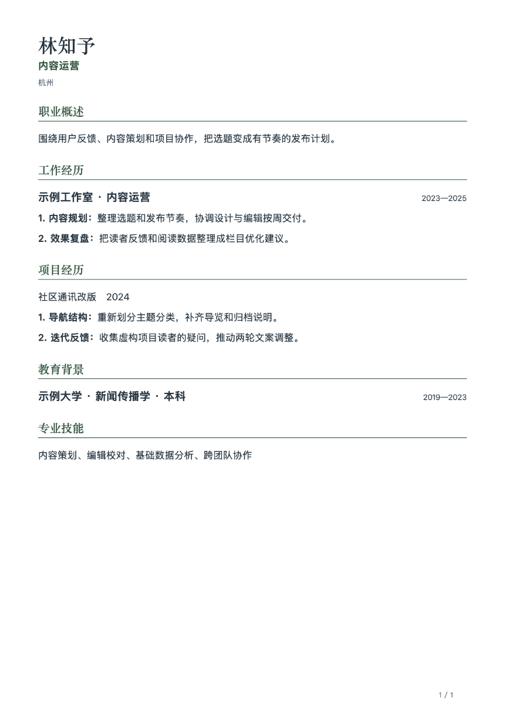
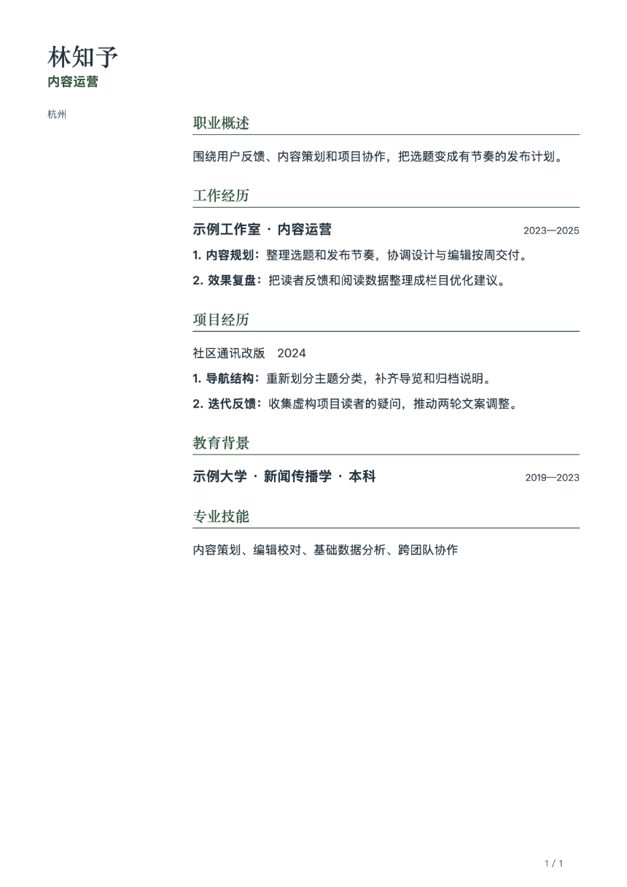

# 简序

**你的经历，值得被更好地看见。**

从已有简历出发，核对每段经历，选一种适合你的排版。你也可以按需使用 AI 建议，逐条决定是否采纳。最后呈现的，是你确认过的版本。

**在浏览器里整理和排版简历。** 导入文本型 PDF 或 Word（DOCX），核对内容、调整版式，导出 PNG、PDF 或可编辑 Word。基础流程无需账号和 AI Key。

[](#启动)

[在本机运行](#启动) · [查看工作台与成品](#工作台与成品)

## 首页导览






## 工作台与成品



[查看完整成品](jianxu-single-column.png)

## 同一份简历，两种排版

以下成品用同一份虚构简历、同一种视觉风格导出。切换布局时，经历内容保持原样。

| 单栏标准 | 左侧信息栏 |
| --- | --- |
| <a href="jianxu-single-column.png"></a> | <a href="jianxu-sidebar.png"></a> |

## 启动

需要 Node.js 22.13 或更新版本与 npm。

```sh
cd product
npm ci --ignore-scripts
npm run build
npm start
```

打开[本地工作台](http://127.0.0.1:4173/workbench/)。样例位于 [`product/tests/fixtures`](product/tests/fixtures)，均为测试用虚构简历。扫描件暂不支持 OCR。PDF 下载保留预览分页，文字为图片。DOCX 保留可编辑文字，分页可能随本机字体及 Word/WPS 变化。

## 数据与连接

基本流程在当前浏览器里处理文件、保留草稿与生成下载。更换浏览器或访问地址会使用独立存储。可选 AI 或 MCP 连接需要主动配置和授权，连接密钥暂存在本机 Node 进程内存。请把 Node 服务留在本机使用。

## 检查与许可

进入 `product/`，可运行 `npm run typecheck`、`npm test` 及 `npm run check:static`。静态检查需要先构建。 [浏览器测试运行方式](product/tests/e2e/README.md)

项目自有代码采用 MIT。第三方依赖保留各自许可。公开版首页背景和风格示例使用本项目生成的替代素材。 [代码许可证](LICENSE) · [依赖说明](product/DEPENDENCIES.md) · [公开版素材](product/public/ASSETS.md)
